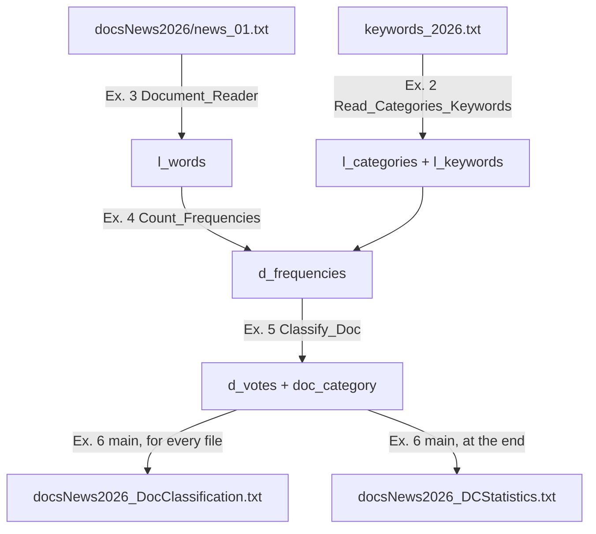

# Project 1 — Document Classification: the guide

**What's in the folder**

| File | What it is |
|---|---|
| `Proj1-DocClass_2026_27.pdf` | the statement (the professor's) |
| `keywords_2026.txt`, `docsNews2026/` | the input data (the professor's) |
| `DocumentClassification.py` | **the solution you hand in**, with the comments the statement makes mandatory (p. 7). Put your names and NIUs at the top first |
| `DocumentClassification_exam_style.py` | the same code without comments, for studying. **Don't upload it** |
| `docsNews2026_DocClassification.txt`, `docsNews2026_DCStatistics.txt` | the two output files, from running it |
| this guide | how it works and how to rebuild it yourself |

**Deadlines** (statement p. 7): `DocumentClassification.py` + presentation PDF on Caronte by **25 Nov 2026**, in pairs, uploaded by one of the two. Presentation **30 Nov / 1 Dec**.

**Only course material.** Every instruction in the code comes either from the statement itself (its hints and remarks) or from the professor's slides, problem sheets and exams. Part 3 gives the source of each one, and Part 4 lists them all.

**Parts:** 1 the big picture · 2 the new tools (sets, dictionaries, `os`, encodings) · 3 every piece of code, explained · 4 where each instruction comes from · 5 how to run it · 6 rebuild it yourself · 7 unclear points to ask · 8 the presentation · 9 practice.

---

## Part 1. What the program does, in one picture

You get 40 news articles and a list of 7 topics, each with its keywords. For each article the program counts how many times each keyword appears, decides the topic, and writes two report files.



The statement's own example, followed all the way through:

| Step | Value |
|---|---|
| keywords file | `medical: physician infection patient care` · `space: planet orbit nasa` · `sports: medal record score team training` |
| the text | `Once rocket23 reached the right distance from the planet, the NASA-team celebrated a big party at the nasa main building with all teams.` |
| Ex. 3: its words | `['once', 'rocket23', …, 'planet', 'the', 'nasa', 'team', …, 'nasa', …, 'teams']` |
| Ex. 4: count the keywords | space: planet 1, orbit 0, nasa 2 · sports: team 1 · medical: all 0 |
| Ex. 5: totals and % | space 3 of 4 = 75 % · sports 1 of 4 = 25 % · medical 0 % |
| Ex. 5: decision | 75 > 50 → **space** |
| Ex. 6: one line of the report | `doc.txt: space(medical:0%, space:75%, sports:25%): nasa:2, orbit:0, planet:1` |

The real run on your folder: 40 txt files → 38 classified, 2 UNKNOWN (news_06, news_30), plus the two non-txt files reported.

---

## Part 2. The new tools (learn these first)

They're Partial 2 material (slides L9c sets, L9d dictionaries), and the `os` module and encodings are given in the statement's Hints (p. 7).

### 2.1 Sets (slides L9c)

**Set** = an unordered collection with **no repeated elements**, written with `{ }`.

```python
s = {"nasa", "orbit", "nasa"}
len(s)              # 2   (the repeated "nasa" is stored once)
"nasa" in s         # True
"team" in s         # False
set("care patient care".split())   # {'care', 'patient'}  (set() turns a list into a set)
```

- No positions: `s[0]` is an error. You can only ask `in`, loop over it (`for x in s`), add (`s.add(x)`).
- **Why the statement uses a set for the keywords:** the only question you ask a keyword collection is "is this word a keyword?", and `in` on a set answers instantly, while `in` on a list checks the elements one by one.
- Non-example: `{}` is **not** an empty set, it's an empty dictionary. An empty set is `set()`.

### 2.2 Dictionaries (slides L9d)

**Dictionary** = a collection of **key → value** pairs. You find a value by its key, not by a position.

```python
d = {}
d["space"] = 3          # new key "space" with value 3
d["space"] += 1         # change the value of an existing key
d                       # {'space': 4}
d["space"]              # 4
"space" in d            # True  (in asks about the KEYS)
for key in d:           # loops over the keys
    print(key, d[key])
```

- A key appears once. Assigning to an existing key replaces its value.
- `d["music"]` when `"music"` isn't a key → ❌ `KeyError`. That's why Ex. 4 first puts every keyword at 0.
- A dictionary remembers the order in which keys were inserted. That's why the output lists the categories in the keywords file's order.

### 2.3 A dictionary of dictionaries (nested dictionary)

The value of a key can itself be a dictionary:

```python
d_frequencies = {"space": {"nasa": 0, "orbit": 0}}
d_frequencies["space"]["nasa"] += 2
d_frequencies           # {'space': {'nasa': 2, 'orbit': 0}}
```

Read `d_frequencies["space"]["nasa"]` left to right: "the inner dictionary of space", then "its value for nasa". Same idea as `L[i][j]` in a list of lists, with names instead of numbers.

### 2.4 Tuples (you know these, L4b)

`d_votes["space"] = (3, 75)` → `d_votes["space"][0]` is 3 (occurrences), `[1]` is 75 (percentage).

### 2.5 String and list instructions used here

| Code | Result | Source |
|---|---|---|
| `"NASA-team".lower()` | `'nasa-team'` | statement Ex. 3 hint |
| `"x".isalnum()`, `"7".isalnum()`, `"-".isalnum()`, `"’".isalnum()` | True, True, False, False | statement Ex. 3 hint |
| `"  hi   there ".split()` | `['hi', 'there']`: with nothing inside, `split()` cuts at **any run** of spaces, tabs or line breaks and ignores the ends | statement Ex. 3 hint |
| `"space: nasa orbit".split(":")` | `['space', ' nasa orbit']` | `split` with a separator, as in every file exercise |
| `"news.TXT"[-4:]` | `'.TXT'` (the last 4 characters) | slicing, L4b |
| `", ".join(["a:1", "b:2"])` | `'a:1, b:2'` (glues the strings with `", "` between them) | L9a, Example 2 solved |
| `"{0:.2f}".format(12.5)` | `'12.50'` (2 decimals) | L5b, `"{0:.10f}".format(...)` |
| `round(74.6)` | `75` | L1b |
| `L.sort()`, `sorted(L)` | the list in order (`sort` changes `L`, `sorted` gives a new one) | L9a |
| `del L[pos]` | deletes position `pos` | L4c |
| `L + ["UNKNOWN"]` | a new list with one more element at the end | L4c |

### 2.6 The `os` module (statement, Hints p. 7)

`import os` at the top of the file.

| Code | What it does |
|---|---|
| `os.listdir("docsNews2026")` | list of the **names** of everything in the folder (`['news_01.txt', …, 'photo_moon_darkside.png']`), in no guaranteed order |
| `os.path.isdir(name)` | True if `name` is an existing folder |
| `os.path.isfile(path)` | True if `path` is an existing file |
| `os.path.join("docsNews2026", "news_01.txt")` | `'docsNews2026/news_01.txt'` on Mac, `'docsNews2026\news_01.txt'` on Windows. **Mandatory** in this project |

Why `join` matters: `listdir` gives only `news_01.txt`. To open it you need the folder in front, and the separator is different on each operating system.

### 2.7 Text encodings (statement, Hints p. 7)

A text file is stored as bytes. An **encoding** is the table that turns bytes into letters. Plain English letters are the same in every encoding; accented letters and curly quotes (`é`, `’`) are not.

- 36 of the 40 news files are UTF-8 (or plain ASCII). **news_01, news_10, news_18 and news_26 are Windows-1252**: reading them as UTF-8 raises `UnicodeDecodeError`.
- So: try UTF-8; if `UnicodeDecodeError`, close and open again with `encoding="windows-1252"`.
- Always write `encoding=` when you open: without it, Python uses the computer's default, which is different on Windows and Mac.

---

## Part 3. Every piece of code, explained

The code below is the exam-style file (no comments), so you see exactly what you'd write. The hand-in file has the same instructions plus comments.

### 3.1 `Read_Text_File(filename)` — our own helper

**Why it exists:** Ex. 2 and Ex. 3 both need "open a file in either encoding and give me its text". The statement says "Feel free to create more functions", so it's written once and called twice.

```python
def Read_Text_File(filename):
    try:
        f = open(filename, "r", encoding="utf-8")
    except:
        raise FileNotFoundError
    try:
        text = f.read()
    except UnicodeDecodeError:
        f.close()
        f = open(filename, "r", encoding="windows-1252")
        text = f.read()
    f.close()
    return text
```

| Line | What it does | Why / source |
|---|---|---|
| `try:` / `open(..., encoding="utf-8")` | opens the file as UTF-8 | Hints p. 7: try UTF-8 first |
| `except:` / `raise FileNotFoundError` | if it can't be opened (doesn't exist, is a folder…), raise the error the main will catch | **copied from the statement's own model** (p. 7) |
| `try:` / `text = f.read()` | reads the whole file into one string | `read()`, L6 Files |
| `except UnicodeDecodeError:` | the bytes aren't valid UTF-8 | Hints p. 7 names this exact error |
| `f.close()` and `open(..., encoding="windows-1252")` | close the first attempt, reopen in the other encoding, read again | Hints p. 7 |
| `f.close()` / `return text` | always close before returning | L6 Files |

Why two separate `try`s: **opening** fails if the file isn't there; **reading** fails if the encoding is wrong. They are different errors at different moments.

### 3.2 Exercise 1 — `DocClass_Welcome()`

```python
def DocClass_Welcome():
    print("Document Classification is typically used in Document Processing for")
    print("assigning categories to documents. Thus, it eases their posterior")
    print("processing and analysis.")
    print()
    print("The program “DocumentClassification” classifies an input folder")
    print("containing documents in txt format. It will also receive a file")
    print("containing information about the topics to classify.")
    print()
    print("The program will generate the following files:")
    print("A txt file containing the category of the documents")
    print("A txt file containing the statistics of the classification")
```

A **procedure** (no `return`, no parameters): one `print` per line of the message, `print()` for each empty line. Copy-paste the lines from the PDF: the corrector compares the text exactly.

**What is it for?** *(your question)* On its own, very little: it's the program's **welcome screen**. The first thing a user sees tells them what the program does and what files it will create, like the help text of any real program. It exists in the project for three reasons:
1. **The user needs to know what to type.** Right after it, the program asks for a keywords file and a folder. Without the message, someone running it doesn't know what those are.
2. **Modular design** (Lesson 9): the main program is written as a list of steps, each one a call (`DocClass_Welcome()`, then ask the file, then…). Putting the message in its own procedure keeps the main short and readable, and the message can be shown again from anywhere with one line.
3. **An easy, checkable first exercise:** it checks that you can define and call a procedure with no parameters and no `return`, and that you copy messages **exactly** (the automatic corrector compares the text character by character). It's the cheapest marks of the project, and the easiest to lose with one typo.

### 3.3 Exercise 2 — `Read_Categories_Keywords(filename)`

**Statement:** returns `l_categories` (list of strings) and `l_keywords` (list of **sets**). One line per category, `name: kw kw kw`, separated by one or more spaces; lines may end with spaces.

```python
def Read_Categories_Keywords(filename):
    l_categories = []
    l_keywords = []
    text = Read_Text_File(filename)
    for line in text.split("\n"):
        if ":" in line:
            parts = line.split(":")
            l_name = parts[0].split()
            if len(l_name) > 0:
                l_categories.append(l_name[0].lower())
                l_keywords.append(set(parts[1].lower().split()))
    return l_categories, l_keywords
```

Traced on the line `space: planet orbit nasa   ` (with spaces at the end):

| Line | Value |
|---|---|
| `text.split("\n")` | the file cut into its lines; this one is `'space: planet orbit nasa   '` |
| `":" in line` | True (an empty line has no `:` and is skipped) |
| `parts = line.split(":")` | `['space', ' planet orbit nasa   ']` |
| `l_name = parts[0].split()` | `['space']` (`split()` also removes any space around the name) |
| `len(l_name) > 0` | True (a line like `: abc` has no name and is skipped) |
| `l_categories.append(l_name[0].lower())` | adds `'space'` |
| `parts[1].lower().split()` | `['planet', 'orbit', 'nasa']`: the extra spaces and the ones at the end disappear |
| `set(...)` then `append` | adds `{'planet', 'orbit', 'nasa'}` at the **same position** as `'space'` (parallel lists) |

**Test** (the statement's example, run): `['medical', 'space', 'sports']` and `[{'physician', 'infection', 'patient', 'care'}, {'nasa', 'planet', 'orbit'}, {'medal', 'training', 'record', 'score', 'team'}]`. The order inside each set looks different from the PDF: sets have no order, and the statement doesn't care.

**Traps:**
- `split(" ")` (with a space inside) instead of `split()`: two spaces in a row produce empty strings `''` that become a fake keyword.
- Without `.lower()` a keywords file with `NASA` would never match, because the documents are lowered.

### 3.4 Exercise 3 — `Document_Reader(filename)`

**Statement:** returns the list of words in order, lowercase. A word = letters and/or digits; every other character separates. Both encodings.

```python
def Document_Reader(filename):
    text = Read_Text_File(filename)
    clean = ""
    for c in text:
        if c.isalnum():
            clean = clean + c.lower()
        else:
            clean = clean + " "
    l_words = clean.split()
    return l_words
```

**The idea:** go through the text character by character. Keep letters and digits (lowered); turn everything else into a space. Then `split()` cuts at the spaces.

Traced on `NASA-team couldn't`:

| `c` | `isalnum()`? | added to `clean` |
|---|---|---|
| N A S A | yes | `nasa` |
| `-` | no | a space |
| t e a m | yes | `team` |
| space | no | a space |
| c o u l d n | yes | `couldn` |
| `'` | no | a space |
| t | yes | `t` |

`clean` = `"nasa team couldn t"` → `split()` → `['nasa', 'team', 'couldn', 't']`, exactly what the statement expects.

**Why `isalnum()` and not a list of separators:** the statement's list of separators ends with "etc.", so it can never be complete. `isalnum()` says what a word **is**, and everything else separates.

**Test** (run): the statement's sentence gives its 23 words exactly.

### 3.5 Exercise 4 — `Count_Frequencies(l_words, l_categories, l_keywords)`

**Statement:** returns `{category: {keyword: occurrences}}`, 0 if a keyword doesn't appear. `team` and `teams` are different.

```python
def Count_Frequencies(l_words, l_categories, l_keywords):
    d_frequencies = {}
    for i in range(len(l_categories)):
        d_frequencies[l_categories[i]] = {}
        for keyword in l_keywords[i]:
            d_frequencies[l_categories[i]][keyword] = 0
    for word in l_words:
        for i in range(len(l_categories)):
            if word in l_keywords[i]:
                d_frequencies[l_categories[i]][word] += 1
    return d_frequencies
```

| Block | What it does | Why |
|---|---|---|
| first `for i in range(len(l_categories))` | creates an inner dictionary for each category, with every keyword at 0 | the "0 if it doesn't appear"; and `+= 1` on a key that doesn't exist would be a `KeyError` |
| `for word in l_words` | one pass over the document | |
| inner `for i …` + `if word in l_keywords[i]` | if the word is a keyword of category `i`, add 1 there | `in` on a set compares **whole** words, so `teams` ≠ `team` |

Why `for i in range(len(...))` (your Lesson 7 rule): two **parallel lists**, category `i` goes with keyword set `i`, so you need the position.

**Test** (run): space `{'nasa': 2, 'planet': 1, 'orbit': 0}`, sports `team` 1, the rest 0, as in the statement.

### 3.6 Exercise 5 — `Classify_Doc(d_frequencies)`

**Statement:** returns `d_votes` `{category: (total_occurrences, total_percentage)}` (two integers) and `doc_category`. Percentage rounded; no division by zero; the category needs **more than 50 %, compared before rounding**, otherwise `"UNKNOWN"`.

```python
def Classify_Doc(d_frequencies):
    d_totals = {}
    total_all = 0
    for category in d_frequencies:
        total_occurrences = 0
        for keyword in d_frequencies[category]:
            total_occurrences += d_frequencies[category][keyword]
        d_totals[category] = total_occurrences
        total_all += total_occurrences
    d_votes = {}
    doc_category = "UNKNOWN"
    for category in d_totals:
        if total_all > 0:
            exact_percentage = d_totals[category] * 100 / total_all
        else:
            exact_percentage = 0
        d_votes[category] = (d_totals[category], round(exact_percentage))
        if exact_percentage > 50:
            doc_category = category
    return d_votes, doc_category
```

| Block | What it does |
|---|---|
| first loop | adds the counts of each category (`d_totals`) and of all of them (`total_all`): two **accumulators** |
| `if total_all > 0` | the division only happens when it's safe; otherwise every percentage is 0 |
| `d_votes[category] = (..., round(exact_percentage))` | stores the tuple with the **rounded** value |
| `if exact_percentage > 50` | the decision uses the **exact** value |

- **Why no search for the maximum:** percentages add up to 100, so **at most one** category can be above 50. If one is, it's automatically the highest.
- **Why "before rounding" matters:** 50.4 % rounds to 50. `50.4 > 50` is True (classified), `50 > 50` is False (wrongly UNKNOWN).

**Tests** (all four of the statement's cases, run):

| Input | Output |
|---|---|
| space 3, sports 1 | `{'medical': (0, 0), 'space': (3, 75), 'sports': (1, 25)}`, `space` |
| space 2, sports 2 | 50 % each → `UNKNOWN` |
| medical 2, three others 1 each | 40 % → `UNKNOWN` |
| no keywords at all | all `(0, 0)`, `UNKNOWN`, no crash |

**Traps:** `>=` instead of `>`; dividing before checking for 0; returning the two values in the wrong order.

### 3.7 Helper — `Is_Txt(file_name)`

```python
def Is_Txt(file_name):
    return file_name[-4:].lower() == ".txt"
```

`file_name[-4:]` = the last 4 characters (slicing, L4b). `.lower()` so `NEWS.TXT` also counts. `news_01.txt` → `'.txt'` → True; `photo.png` → `'.png'` → False. It returns the comparison directly (True/False), like the class comparison methods.

### 3.8 Helper — `Folder_Has_Txt(folder_name)`

```python
def Folder_Has_Txt(folder_name):
    found = False
    if os.path.isdir(folder_name):
        l_files = os.listdir(folder_name)
        i = 0
        while i < len(l_files) and not found:
            if Is_Txt(l_files[i]) and os.path.isfile(os.path.join(folder_name, l_files[i])):
                found = True
            else:
                i += 1
    return found
```

The **search** pattern (Lesson 7, shape 3): stop at the first txt file found. If the folder doesn't exist, `os.path.isdir` is False and `found` stays False. Used by the main to re-ask the folder.

### 3.9 Helper — `Line_Of_Document(...)`

Builds one line of the classification file, for example `news_01.txt: music(football:0%, …, music:100%, aviation:0%): album:0, band:0, …`.

```python
def Line_Of_Document(file_name, d_votes, doc_category, d_frequencies):
    l_parts = []
    for category in d_votes:
        l_parts.append(category + ":" + str(d_votes[category][1]) + "%")
    line = file_name + ": " + doc_category + "(" + ", ".join(l_parts) + ")"
    if doc_category != "UNKNOWN":
        l_counts = []
        l_names = []
        for keyword in d_frequencies[doc_category]:
            l_names.append(keyword)
        l_names.sort()
        for keyword in l_names:
            l_counts.append(keyword + ":" + str(d_frequencies[doc_category][keyword]))
        line = line + ": " + ", ".join(l_counts)
    return line
```

| Block | Builds |
|---|---|
| first loop | `['football:0%', 'space:0%', …]` from the rounded percentages (`d_votes[category][1]`) |
| `", ".join(l_parts)` | `'football:0%, space:0%, …'` |
| `if doc_category != "UNKNOWN"` | only classified documents get the keyword counts |
| `l_names` + `.sort()` | the winning category's keywords in **alphabetical** order (sets have no order; the statement's example is alphabetical) |
| second `join` | `'album:0, band:0, …'` |

### 3.10 The main program (Exercise 6), block by block

**Step 1 — welcome**

```python
# 1. Welcome
DocClass_Welcome()
```

**Steps 2–3 — the keywords file, re-asked until valid**

```python
# 2-3. Keywords file (re-ask until valid)
l_categories = []
while len(l_categories) == 0:
    keywords_file = input("Enter the name of the keywords file: ")
    try:
        l_categories, l_keywords = Read_Categories_Keywords(keywords_file)
        if len(l_categories) == 0:
            print("Error: the file contains no data.")
    except FileNotFoundError:
        print("Error: the file does not exist.")
```

- "Ask again until valid" = a validation `while` (Lesson 5). Two ways to be invalid: the file doesn't exist (`FileNotFoundError`, raised by `Read_Text_File`) or it has no data (the list comes back empty).
- The loop condition is "no categories yet", so one `while` covers both errors.

**Step 4 — the folder, re-asked until valid, and the counters**

```python
# 4. Folder (re-ask until valid)
folder_name = input("Enter the name of the folder with the documents: ")
while not Folder_Has_Txt(folder_name):
    print("Error: the folder does not exist or contains no txt files.")
    folder_name = input("Enter the name of the folder with the documents: ")
base_name = folder_name
if base_name[-1] == "/" or base_name[-1] == "\\":
    base_name = base_name[:-1]

total_txt = 0
d_category_docs = {}
for category in l_categories + ["UNKNOWN"]:
    d_category_docs[category] = 0
d_keyword_totals = {}
for keywords in l_keywords:
    for keyword in keywords:
        d_keyword_totals[keyword] = 0
```

| Block | What it does |
|---|---|
| `while not Folder_Has_Txt(folder_name)` | validation `while`: not a folder, or no txt inside → ask again |
| `base_name` | the folder name for the output files; if the user typed a final `/` (or `\` on Windows), slicing removes it. (`"\\"` is how you write **one** backslash inside a string) |
| `d_category_docs` | one counter per category, plus `UNKNOWN`, all at 0 |
| `d_keyword_totals` | one counter per keyword, all at 0 |

**Step 5 — classify every file**

```python
# 5. Classify every file
out = open(base_name + "_DocClassification.txt", "w", encoding="utf-8")
for file_name in sorted(os.listdir(folder_name)):
    file_path = os.path.join(folder_name, file_name)
    if os.path.isfile(file_path):
        if Is_Txt(file_name):
            try:
                l_words = Document_Reader(file_path)
                d_frequencies = Count_Frequencies(l_words, l_categories, l_keywords)
                d_votes, doc_category = Classify_Doc(d_frequencies)
            except FileNotFoundError:
                print("Error: the file", file_name, "could not be read.")
            else:
                out.write(Line_Of_Document(file_name, d_votes, doc_category, d_frequencies) + "\n")
                total_txt += 1
                d_category_docs[doc_category] += 1
                d_doc_keywords = {}
                for category in d_frequencies:
                    for keyword in d_frequencies[category]:
                        d_doc_keywords[keyword] = d_frequencies[category][keyword]
                for keyword in d_doc_keywords:
                    d_keyword_totals[keyword] += d_doc_keywords[keyword]
        else:
            out.write("Attention: the following non txt file has been detected: " + file_name + "\n")
out.close()
```

| Line | What it does |
|---|---|
| `sorted(os.listdir(folder_name))` | every name in the folder, alphabetically (`listdir` has no fixed order), so the output goes news_01 … news_40, then the non-txt files |
| `os.path.join(folder_name, file_name)` | the full path (mandatory) |
| `if os.path.isfile(file_path)` | ignores sub-folders |
| `if Is_Txt(file_name)` | txt → classify; else → the "Attention" line, exactly as the statement writes it |
| `try` → Ex. 3, 4, 5 | the three functions, in the statement's order |
| `except FileNotFoundError` | a file that can't be opened doesn't stop the program |
| `else:` | runs only if there was no error (L7 debugging, `try`/`except`/`else`): write the line, then update the statistics |
| `d_doc_keywords` | each keyword's count in this document, counted **once** even if the keyword belonged to two categories (it's the same word in the text) |

**Step 6 — the statistics file**

```python
# 6. Statistics
stats = open(base_name + "_DCStatistics.txt", "w", encoding="utf-8")
stats.write("*** Statistics\n")
stats.write("Total txt files: " + str(total_txt) + "\n")
for category in l_categories + ["UNKNOWN"]:
    if total_txt > 0:
        percentage = d_category_docs[category] * 100 / total_txt
    else:
        percentage = 0
    stats.write(category + ": " + "{0:.2f}".format(percentage) + "%\n")
stats.write("\n*** Top 10 keywords\n")
l_names = []
for keyword in d_keyword_totals:
    l_names.append(keyword)
l_names.sort()
l_counts = []
for keyword in l_names:
    l_counts.append(d_keyword_totals[keyword])
k = 0
while k < 10 and len(l_names) > 0:
    pos = 0
    for i in range(1, len(l_counts)):
        if l_counts[i] > l_counts[pos]:
            pos = i
    stats.write(l_names[pos] + ": " + str(l_counts[pos]) + "\n")
    del l_names[pos]
    del l_counts[pos]
    k += 1
stats.close()
```

| Block | What it does |
|---|---|
| `l_categories + ["UNKNOWN"]` | the categories in the keywords file's order, then UNKNOWN |
| `"{0:.2f}".format(percentage)` | always 2 decimals: `15.00`, `12.50` |
| `l_names` (sorted) + `l_counts` | two **parallel lists**: keywords alphabetically and their totals |
| the `while k < 10` loop | 10 times: find the **position of the maximum** (the running-max pattern from Lesson 5), write it, delete it from both lists with `del` (L4c), so the next turn finds the next one |
| strict `>` | on a tie the first one found stays, and since the list is alphabetical, ties come out alphabetically |
| `len(l_names) > 0` | in case a keywords file has fewer than 10 keywords |

**Output files:** both are created with just their name, so they land in the folder you run the program from. Run it from the project folder, as the statement assumes.

**Result on your data (run):** 40 txt files; football 15 %, space 12.5 %, health 15 %, weather 15 %, elections 15 %, music 12.5 %, aviation 10 %, UNKNOWN 5 %. Top: `space` 73, `club` 27, `flight` 23, `nasa` 20 … I recounted all the top-10 numbers with a completely separate method and got the same values.

---

## Part 4. Where each instruction comes from

| Instruction | Source |
|---|---|
| `import os`, `os.listdir`, `os.path.isdir`, `os.path.isfile`, `os.path.join` | statement, Hints p. 7 |
| `open(..., encoding=...)`, `UnicodeDecodeError`, `"utf-8"`, `"windows-1252"` | statement, Hints p. 7 |
| `try` / `except:` / `raise FileNotFoundError` | statement, Remarks p. 7; slides L7 debugging |
| `try` / `except` / `else` | slides L7 debugging |
| `isalnum()`, `lower()`, `split()` | statement, Ex. 3 hint |
| `if __name__ == "__main__":` | statement, Remarks p. 6; P0 Voting solved |
| `read()`, `write()`, `close()`, `"w"` | slides L6 Files |
| sets, `set(...)`, `in` on a set | slides L9c |
| dictionaries, nested dictionaries | slides L9d |
| tuples | slides L4b |
| slicing `[-4:]`, `[:-1]`, indexing `[-1]` | slides L4b |
| `split(":")`, `split("\n")` | slides L4b; every file exercise |
| `append`, `del L[pos]`, list `+` | slides L4c |
| `sort()`, `sorted()`, `join()` | slides L9a; Example 2 solved |
| `"{0:.2f}".format(x)` | slides L5b (`"{0:.10f}".format(...)`) |
| `round()` | slides L1b |
| search with `while … and not found`, running maximum, validation `while`, counters | Lessons 5 and 7 (your lessons) |
| docstrings `"""…"""` (hand-in file only) | P0 Voting solved |

---

## Part 5. How to run it

1. Put `DocumentClassification.py`, `keywords_2026.txt` and the `docsNews2026` folder **in the same folder** (they already are).
2. **Terminal:** type `cd ` and drag the project folder into the window, Enter; then `python3 DocumentClassification.py`, Enter. **Spyder / PyCharm / VS Code:** open the file and press Run. The working directory must be the project folder (in VS Code, open the whole folder).
3. Answer the two questions. A real run, including a wrong name:
```
Enter the name of the keywords file: keywords.txt
Error: the file does not exist.
Enter the name of the keywords file: keywords_2026.txt
Enter the name of the folder with the documents: docsNews2026
Done: files docsNews2026_DocClassification.txt and docsNews2026_DCStatistics.txt have been created.
```
4. The two output files appear next to the script. Running it again overwrites them (`"w"`).

You type the folder name once: `os.listdir` finds all 40 files and the `for` loop goes through them. Good demo for the teacher: a wrong name first (shows the error handling), then the right ones, then open the outputs and explain one line.

---

## Part 6. Rebuild it yourself from scratch (the real practice)

Make an empty file `my_DocClass.py` next to the data. Do one step, run its test, and only then go on. Open the solution only if you're stuck for more than 10 minutes on a step.

| Step | Write | Test (under `if __name__ == "__main__":`) | Expected |
|---|---|---|---|
| 1 | `import os`, the main guard, `DocClass_Welcome()` | call it | the message, identical to the PDF |
| 2 | `Read_Text_File` (UTF-8 only at first) | `print(Read_Text_File("keywords_2026.txt"))` | the 7 lines |
| 3 | add the Windows-1252 retry | `print(len(Read_Text_File(os.path.join("docsNews2026", "news_01.txt"))))` | a number, no `UnicodeDecodeError` |
| 4 | `Read_Categories_Keywords` | a `test_kw.txt` with the statement's 3 lines (add double spaces and trailing spaces on purpose) | the statement's two lists |
| 5 | `Document_Reader` | a `test_doc.txt` with the statement's sentence | the statement's 23 words |
| 6 | `Count_Frequencies` | the statement's second sentence + `test_kw.txt` | the statement's nested dictionary |
| 7 | `Classify_Doc` | the four cases of the table in 3.6 (build the dictionaries by hand) | the four outputs |
| 8 | `Is_Txt`, `Folder_Has_Txt` | `Is_Txt("A.TXT")`, `Is_Txt("x.png")`, `Folder_Has_Txt("docsNews2026")`, `Folder_Has_Txt("nope")` | True, False, True, False |
| 9 | main steps 2–4 (the two re-ask loops) | type a wrong name, then the right one | it asks again, then continues |
| 10 | main step 5, first only `print` each line | run on `docsNews2026` | 40 lines + 2 Attention lines |
| 11 | write the lines into the file | open the output file | the same lines |
| 12 | main step 6 | open the statistics file | the numbers in 3.10 |
| 13 | comments, names and NIUs at the top | read it as if you were the professor | |

**Final checklist before handing in**

1. Function names, parameter names and return order **exactly** as the statement.
2. Messages copied from the PDF.
3. `os.path.join` for every file inside the folder.
4. Every `open` has `encoding=`; every file is closed.
5. Errors handled: missing file, empty file, missing folder, folder without txt, division by zero.
6. Comments on every function and every main step.
7. Only the standard library (`os`).
8. Run it once on a **different** keywords file (invent 3 categories) to prove it isn't tied to these 7.

---

## Part 7. Where the statement is unclear (what we chose, and what to ask the professor)

| Point | The problem | What the code does | Ask? |
|---|---|---|---|
| Space before `(` in UNKNOWN lines | the format line says `UNKNOWN(`, the example says `UNKNOWN (` | no space (follows the format line, same as the classified lines) | **yes**: an automatic corrector compares text exactly |
| Ties in the top 10 | 10th place is a tie: `covid`, `disease` and `singer` all have 11 | ties alphabetical → `covid` is 10th | **yes** |
| Order of the keywords in each line | not stated; the example is alphabetical | alphabetical | no |
| Order of the files | `listdir` has no fixed order | `sorted` (news_01 … news_40, then the non-txt files, as in the example) | no |
| Rounding of x.5 | Python's `round` rounds halves to the even number (`round(12.5)` = 12, `round(13.5)` = 14) | `round` | none of the 40 files is affected |
| Input prompts and re-ask error messages | not given in the statement | our own wording | no (only the given messages must match) |

---

## Part 8. The presentation (part of the grade)

The statement asks for (1) an explanation of your code (Part 3 is that, slide by slide) and (2) **alternative data structures** for the ones used, with advantages and disadvantages:

| Now | Alternative | Advantages | Disadvantages |
|---|---|---|---|
| `l_keywords`: list of **sets** | list of **lists** | keeps the file's order; lists are the first structure of the course | `word in list` checks one by one, slower with many keywords; repeated keywords would be stored twice |
| `l_categories` + `l_keywords`: two parallel lists | **one dictionary** `{category: set_of_keywords}` | one structure, the two lists can't get out of step; look a category up by name | no positions |
| `d_frequencies`: dict of dicts | **list of lists** of counts, `freq[i][j]` = keyword j of category i | simple, fast by position | you must remember which `i` is which category and which `j` which keyword; unreadable |
| `d_frequencies` | **list of tuples** `(category, keyword, count)` | flat, easy to sort and print | finding one count means searching the whole list |
| `d_votes`: dict of tuples | **two parallel lists** (occurrences, percentages) | no tuples needed | three lists to keep aligned; more chances of an index error |
| `l_words` (list) | a dictionary `{word: count}` | each word counted once, then keywords looked up: faster on long texts | the statement asks for the words **in order**, which a dictionary of counts loses |

Suggested slides: 1 title and group · 2 the problem and the pipeline (Part 1 diagram) · 3–7 one per exercise (input → idea → key lines) · 8 encodings and error handling · 9 results on the 40 files · 10–11 the alternatives table · 12 what was hard and how you tested it.

---

## Part 9. Practice (answer before reading the answers)

1. What does `Document_Reader` return for a file containing `Hello,world! It's 2026`?
2. Why does `Count_Frequencies` crash with `KeyError` if you remove the "all at 0" part?
3. `d_votes = {'a': (3, 60), 'b': (2, 40)}`. What's the category? And with `{'a': (1, 50), 'b': (1, 50)}`?
4. In `Read_Categories_Keywords`, why `parts[1].split()` and not `parts[1].split(" ")`?
5. Write a function `Count_Txt(folder_name)` that returns how many txt files a folder has (use `os.listdir`, `os.path.join`, `os.path.isfile` and `Is_Txt`).

> [!solution]- Answers
> 1. `['hello', 'world', 'it', 's', '2026']`.
> 2. `d_frequencies[category][word] += 1` reads the old value first; if the key was never created, there is no old value → `KeyError`.
> 3. `a` (60 > 50). Then `UNKNOWN` (50 is not > 50).
> 4. `split(" ")` cuts at **every single** space, so two spaces in a row, or spaces at the end of the line, produce empty strings `''` that would become a keyword. `split()` cuts at runs of spaces and ignores the ends.
> 5. ```python
>    def Count_Txt(folder_name):
>        count = 0
>        for name in os.listdir(folder_name):
>            if Is_Txt(name) and os.path.isfile(os.path.join(folder_name, name)):
>                count += 1
>        return count
>    ```
>    On `docsNews2026` → 40.
